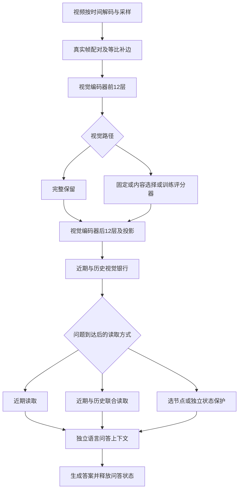

# 流式视频模型联合阶段研究进展

**2026年11月5日增补**　剪枝银行训练、更新验收修补与StreamingBench补测见第6.7—6.8节；新历史收益头训练及分项表现见第7.10节。

## 视觉剪枝、历史读取与证据评测

**汇报范围：**承接《2B流式视频与长短期记忆阶段综合汇报》PDF已覆盖的A06、LS及首轮full48／odd24／ToMe24实验，整合其后至2026年11月3日的双方工作。10月28日阶段报告和11月2日交接为中间材料，不作为本报告的起始界线。旧报告中的2B迁移与早期状态续接仅作必要承接。

**阅读说明：**本报告按研究问题组织，不按作业提交顺序展开。正文中的“正确”默认指选项所表达的答案内容正确，格式合规另列；解释是否有画面依据使用单独指标。训练、开发、回归、机制诊断及成本测量分别标明，避免不同用途的分数混在一起。

**证据与分工：**本方结果据已归档输出、分析文件和执行源码整理；搭档部分据其共享复盘及获授权的只读结果核对，未重新运行其模型。本次已核到搭档200题开放问答的800份生成完成回执，但尚未取得最终内容评分汇总，因此该项不列算法排名。持续进度以[实验总纲](<E:/VIT Model/实验总纲.md>)为准，本报告是一份阶段快照。

## 工作导图


可编辑版本：[Obsidian工作导图](流式视频模型联合阶段研究进展_20261103.canvas)。图中的五条分支对应输入验证、视觉压缩、剪枝训练、记忆读取与评测。图用于导航，具体实验口径以下文为准。

## 1．阶段目标与主要进展

本阶段的共同目标，是在有限计算与存储预算下持续接收视频，既能回答当前发生的事情，也能利用此前保留下来的历史。围绕这个目标，双方分别推进视觉侧压缩与训练、历史存储与读取、基础理解诊断，以及更能区分真实观察和答案猜测的评测。

目前最明确的进展，不是某个复杂模块在所有任务上取胜，而是已经建立了可复核的改动与效果链条：输入工程能够减少解码成本；视觉中层删减能够减少后续视觉计算；训练退化经过对照诊断得到实质修补；新的辅助评测能够揭示部分“选项答对，但解释没有充分依据”的情况。记忆读取与近期保护存在局部改善，同时也暴露出跨任务迁移和额外成本问题。

| 工作 | 实际完成的改动 | 当前证据与结论 |
|---|---|---|
| 输入工程V0 | 改变文件解码并行配置，保持既定采样、PTS和画布处理 | 固定本机面板输入耗时减少46.45%；后续集群核对采样与原答案。属于工程收益 |
| 投影后Token压缩 | 固定、多样性、变化、混合和问题条件选择 | 能降低读取量；部分任务有收益，但覆盖扩大和表示损失同时存在 |
| 视觉中层剪枝 | 在24层视觉编码器前12层后，保留一半完整空间组 | 独立运行有视觉耗时节省；完整流程收益受解码占比限制 |
| 剪枝训练修补 | 从连续偏置配合硬排序，改为二值前向与替代梯度 | 开发230→248/345，旧题回归193→214/307；恢复了首版退化，尚未稳定超过固定剪枝 |
| 条件读取 | 时间词规则、收益头、API监督头、节点选择头 | 旧API33头在熟悉面板有局部作用；扩大比较后未稳定胜过简单规则 |
| 近期保护 | 最新画面完整保留、历史与近期独立预填充、状态通道对照 | 小型配对诊断出现改善；478题与StreamingBench扩大比较未形成稳定净收益 |
| 新评测 | 选项答案与视觉依据分开，匿名辅助判读；搭档开展无选项问答 | 能发现原正确率表遗漏的问题；裁判分数仍是辅助证据，不等于模型内部因果解释 |

本方重点是视觉压缩、训练与修补、读取小头和辅助证据评测。搭档重点是记忆策略、输入与动作理解、近期与历史的受控比较，以及开放问答。两边共同使用的结果注明来源，组合与迁移不重复算作两项独立成果。

## 2．整体架构：各项工作究竟改在哪里

### 2.1 从视频输入到回答的路径



多数本阶段比较使用**有界视觉银行路径**：长期保留视觉特征、原空间坐标、时间与来源信息；到提问时，才为选中的证据建立语言上下文。它不暗中持有一份观察主状态的完整语言KV，因此可以判断收益来自哪些已保存证据。

早期持续观察主状态仍是另一条已有路径，维护注意力KV、卷积缓冲及Gated DeltaNet递归状态，提问时复制后回答。本阶段银行实验的成本与能力不能自动当作该观察路径的结果。两种路径均隔离问答，但保存对象不同。

### 2.2 三种压缩位置，节省的成本不同

| 改动位置 | 可以减少什么 | 不能直接声称减少什么 |
|---|---|---|
| 文件解码与采样实现 | 解码和输入处理时间 | 模型自身理解难度 |
| 完整视觉编码后删投影Token | 银行载荷、语言prefill与问答缓存 | 已经发生的完整视觉编码 |
| 视觉中层真正删除空间组 | 后续视觉层计算，以及投影与语言读取量 | 前半视觉层、原始解码；整体成本也不会按Token比例同比下降 |

这里的prefill指模型在生成答案前读取输入上下文。少读Token通常能减轻这一步，但如果视频解码占了大部分时间，完整流程不会同比加速。

### 2.3 参数和容量必须连同输入一起理解

当前主要参考精度为FP32，集群设备为A800。288×384输入下，一个真实帧对经过空间合并得到9×12＝108个投影视觉Token；384×512对应192个。原192×256实验则为48个。报告中的“54”是288×384下保留一半空间组，不能与早期24Token当成相同质量条件。

完整108、最近8帧对的视觉载荷为864Token；54Token剪枝若仍只保存8对则为432Token；若使用相同864上限，可保存16对。后者同时改变了历史范围。**相同Token预算不等于相同画面覆盖，也不等于相同总显存。**选择器缓存、事件描述子、模型权重与语言问答状态需要另计。

## 3．数据与比较口径

### 3.1 按用途理解现有数据

以下并非彼此独立、可以直接相加的全部题库。辅助题和成本题取自综合测评，旧题回归也已经被查看和分析。

| 名称 | 构成 | 主要用途 | 需要记住的限制 |
|---|---|---|---|
| 早期记忆比较 | 171＋T98＝269题，另34个长视频问时 | 对照M0/M2/A06/LS及投影压缩 | 已打开；许多题不必依赖远期证据 |
| S-EMBER主面板 | 128来源、478题 | 多分钟记忆、位置、细节、计数与顺序 | 已用于方法开发，不再作为未见测试 |
| 搭档S-EMBER诊断 | 18来源、102题 | 分辨率、采样、记忆与选项排列稳定性 | 多种排列是相关重复回答 |
| 剪枝训练 | 150视频、1237题 | 更新评分器参数 | 不拿训练成绩代替泛化 |
| 选版本开发 | 40视频、345题 | 比较配方与checkpoint | 可以用于选版本，因此不再是独立测试 |
| 旧题回归 | 38视频、307题 | 冻结版本后检查改善与退化 | 已经打开，不能反复据其调参后仍称留出集 |
| 日常综合测评 | NExT-QA 150＋StreamingBench 150＝300题 | 多任务比较完整、固定、内容、CE和文字 | Next来自上述78个非训练视频；两数据集分报 |
| 解释辅助 | Next23＋Stream22＝45题 | 方法接近时分析解释依据和事实错误 | 属于300题子集；两套裁判分开报告 |
| 持续输入成本 | Stream中20视频20题、10题型 | 方法各自从头处理至提问时刻，测完整成本 | 不是额外20道独立能力验证 |
| 当前/旧题配对诊断 | 5视频，12当前问时＋6旧问时 | 检验当前感知和历史收益能否兼得 | 单助手开发材料，不能凭18题定全局排名 |
| 本轮组合扩量 | Next75＋Stream75＝150题、126视频文件 | 四种视觉路径接四种银行 | 从已打开300题分层取半，正在运行 |

另有StreamingBench **959题简答回归**，用于早期免训练剪枝验证。它与后来的150题部分重合，而且输出协议不同，不能把959＋150视为1109道独立测试或直接拼接正确率。

训练隔离审计对150个训练视频与开发345、回归307、综合300及辅助45分别核对题目ID、视频ID和记录媒体SHA，交集均为0。NExT素材的官方来源split可以同为train，但项目内部按视频划分；这不代表已经证明不同编码片段、同一拍摄场次或预训练数据完全无重合。后者没有完成全面审计。[S3]

### 3.2 S-EMBER的时长与题型

主128视频累计约19.43小时，单文件约5—20分钟。累计时长只是资源总量，并非一个连续19小时会话。

| 文件时长 | 视频数 | 问题数 |
|---|---:|---:|
| 5—8分钟 | 61 | 222 |
| 8—12分钟 | 51 | 195 |
| 12分钟及以上 | 16 | 61 |
| 合计 | 128 | 478 |

| 题型 | 题数 | 考察内容示意 |
|---|---:|---|
| 物体／事件计数 | 68 | 某动作发生几次、拿出了几个物体 |
| 位置追踪 | 56 | 物体后来放到了哪里 |
| 对象比较 | 43 | 不同时刻或对象的属性差异 |
| 动作步骤 | 59 | 操作过程和步骤关系 |
| 空间推理 | 41 | 方向、相对位置、返回路径 |
| 时间顺序 | 35 | 哪个事件先发生、第一次或最后一次 |
| 时长 | 85 | 某事件持续多久、过去多久 |
| 视觉细节回忆 | 91 | 颜色、文字、标识与外观 |

提问时刻减作者证据末端的代理间隔中，少于30秒250题，30—120秒143题，120—300秒60题，至少300秒25题。它不是“距最后一次唯一充分证据多久”的人工确认值，不能排除重复线索。[S1]

### 3.3 综合300题的长度、类型与问题示例

| 子集 | 视频文件与题数 | 文件长度 | 模型读取方式 |
|---|---|---|---|
| NExT-QA | 78文件、150题 | 10.01—19秒 | 2FPS读完整短片，在EOF回答 |
| StreamingBench | 144文件、150题 | 90—1121.84秒 | 原剪枝测评按1FPS取提问前最近8对；问题时刻2—1005秒 |

StreamingBench文件长，不表示上述近期窗口实验看完了全段。后续持续输入成本与银行组合实验才从开头逐对处理至相同截点。

NExT-QA的八类题数为：方式CH24、原因CW22、计数DC13、位置DL22、其他描述DO22、当前/同时关系TC22、后续TN21、先前TP4。示例有“猫是什么颜色”“女孩在狗停止舔杯子时有什么反应”“黑衣男子最后接球前做了什么”。

StreamingBench十类题数为：动作18、属性18、因果12、总结15、计数12、事件15、物体15、预测15、空间15、读字15。示例有“球员现在正在做什么”“到目前为止插入了几次电影片段”“桥现在位于骑行者的哪个方向”“计时器显示什么”。这些题的证据需求不同，近期窗口足以回答部分当前题，却可能无法回答累计题。[S4]

### 3.4 四类数字分别报告

1. **答案内容正确率：**是否答到原标签对应的选项内容，不因额外文字或缺少固定标题自动判错。
2. **格式与可解析性：**是否能可靠提取选项，是否存在冲突或截断；无法判断时透明单列。
3. **视觉依据质量：**回答中的关键观察是否受到实际输入支持，是否存在与画面矛盾的核心事实。
4. **资源成本：**输入、视觉、选择、银行、语言读取、生成和实际载荷分别计量。

同一问题轮换选项顺序，是为了检查是否偏向某个字母或位置。它不产生新的独立问题。例如102题×5排列得到510条相关回答，报告仍将其称为102题的五排列测量。

## 4．基础验证：把输入问题与记忆问题分开

### 4.1 S-EMBER低分不能直接归因于流式改造

本方478题以0.5FPS、288×384、FP32和最多16输出Token比较。几个核心参照如下：

| 路径 | 正确/478 | 用途 |
|---|---:|---|
| 纯文字 | 106 | 检查题目和选项先验 |
| 完整近期M0，8对 | 111 | 固定近期范围的视觉参照 |
| M2完整银行 | 113 | 原森林 |
| A06完整银行 | 122 | 控制融合深度 |
| LS完整银行 | 118 | 共享历史容量 |
| 完整流式历史 | 135 | 更多历史证据的质量参照，使用项目续接内核 |

五选一均匀随机期望为20%，即约95.6/478；纯文字不是随机规则，不能与随机期望混为一谈。完整历史相对纯文字纠正73题、损失44题，净增29，说明部分视觉信息有效，但总体能力仍弱。完整历史计数只有7/68，文字10/68；细节回忆38/91对文字23/91。不能用一个总分掩盖题型差异。[S1]

原生核查分两次完成，面板不同，不能把分数直接相减：

- 第一批24题：官方默认视频读取5/24；官方匹配帧对输入9/24；同题完整流式9/24。默认读取还改变采样和缩放，并非只更换语言实现。
- 后一批同输入24题：固定RGB、PTS、处理像素、投影、Token和位置，官方完整语言计算与流式分块均7/24，生成ID逐题相同。首次logits满足预定绝对加相对容差；最大绝对差约0.000102，不能说逐位相同。

后一组最长输入23,119Token，在其FP32/MATH设置下，完整前填峰值allocated约48.06GiB，分块续接约10.02GiB。这个差异属于同历史计算的临时内存管理，不能归功于银行压缩，也不能外推到所有后端或端侧。[S5]

这些核查支持：**在已测固定输入范围内，没有观察到状态续接造成的新增答案损失。**它不证明所有输入都无损，也不证明后续剪枝与记忆融合无损。

### 4.2 分辨率、时间密度与动作理解的协作结果

搭档在102题×5排列的原生分辨率对照中，低／中／高分辨率正确率约28.43%／34.31%／35.10%。品牌、贴纸和标识等细节有明显改善，但计数和动作关系仍弱；更高分辨率的额外视觉成本需要单独承担。

本方478题的LS中档完整为118，高档完整128，高档编码后再选回108Token为114。中高完整还把银行预算864改到1536，不能把全部增分归于清晰度。独立57题面板中，高档完整总处理时间比中档增加23.79%，高档压回108仍增加16.59%。[S1]

搭档进一步把“看几帧”和“按多少FPS观察”拆开，相关共享结果如下。本方本次依据其复盘整理，未重新跑其GPU任务。[S2]

| 搭档对照 | 结果 | 说明 |
|---|---|---|
| 30个相关动作片段，均匀16／32帧 | 原生15/30、14/30；文字5/30 | 相关视觉有用，但更多帧没有自动提高成绩 |
| 同16帧接LS／A06 | 15/30、14/30 | LS未发生压缩；不能据此称其压缩无损 |
| 同32帧、8帧对等价银行预算 | LS12/30、A06 13/30，原生14/30 | 容量压力下减少读取量伴有质量取舍 |
| 同30片段，1／3／5FPS | 原生13/15/14；LS12/11/11；A06 13/11/8 | 帧率提高也增加融合压力、缩短固定近期槽的时间范围 |
| 5FPS下覆盖抽样／覆盖＋变化 | 14/30、13/30 | 简单覆盖已具竞争力，混合首版无净收益 |

计数160题使用提问前最近16帧，原生11/160、文字32/160。其重要教训是**读取范围与累计问题不匹配**：无法用这组结果证明视频无用，也不能让记忆算法为根本没读入的事件负责。

搭档的139题因果连续输入实验更进一步，包含109道OVO当前动作题与30道S-EMBER历史题，分开统计：

| 条件 | 当前动作/109 | 历史/30 |
|---|---:|---:|
| 原模型最近8帧 | 69 | 8 |
| 原模型最近16帧 | 62 | 6 |
| A06只读近期8帧 | 69 | 8 |
| A06读取全部已保存记忆 | 62 | 6 |
| 纯文字 | 28 | 5 |

A06联合相对近期在当前题纠正2、损失9，在历史题纠正2、损失4。这批没有复现“加历史一定帮助旧题”的假设，提示必须检查实际保留内容及可读性。当前题与旧题来自不同数据集，不能把两列差异全部归因时间距离。

### 4.3 基础能力增强尝试简述

| 尝试 | 关键结果与教训 | 当前处理 |
|---|---|---|
| EPIC普通动作LoRA | 固定局部分类80→95/191，有局部改善，但拿取等类别退化，未形成可靠原题迁移 | 保留结果，不继续作为主线扩训 |
| VideoMAE专家监督 | 对齐教师和打乱教师对照均未超过普通LoRA的95/191 | 更强或专门教师不等于监督必然有效；停止首版 |
| 连续事件区间与程序计数 | 训练和事件账本可运行，但观察漏报、误报和单位问题仍影响累计 | 链路完成不作为计数能力改善 |
| 9B基座 | 熟悉同刻双对有改善，但官方题未同步提高，不能替代具体任务验证 | 保留诊断，未把整个项目切换9B |

这组尝试不再逐次展开。它们共同说明：提高容量、加入教师或把累计交给程序，都需要首先验证局部观察能否稳定产生正确事件；仅让模型多描述几句话并存起来，可能将错误持久化。[S1、S2]

## 5．视觉压缩：从投影选择到真正减少编码

### 5.1 投影后选择的作用与局限

最初每帧对48Token，对照完整、固定奇数位置、相似融合ToMe、多样性Div24、纯变化change24，以及固定空间＋变化mix24。完整编码已经完成后再选Token，主要减少存储和语言读取。

变化选择的核心是同空间位置前后两帧对的特征差异：

```python
# 概念上对应 2b-temporal24-v1/selection.py
score = 1 - cosine_similarity(current_feature, previous_feature)
ids = argsort(score, descending=True)[:24]
ids = sort(ids)                 # 恢复原空间顺序
selected = current_feature[ids] # 保留当前真实值和原坐标
```

变化可以来自新动作，也可以来自镜头移动和光照；静态文字或物品细节可能分数很低。选择器还持有上一份完整特征，不能只按输出Token数计算总内存。

| 投影读取方法 | 269题正确 | 长视频支持16题 |
|---|---:|---:|
| 完整48 | 164 | 9 |
| 固定odd24 | 162 | 11 |
| 空间交错24 | 161 | 10 |
| ToMe24 | 158 | 9 |
| Div24 | 159 | 8 |
| change24 | 167 | 9 |
| mix24 | 159 | 8 |

change在主集相对odd净增5题，但长题少2题。这是值得保留的信号，而非通用压缩结论。269题都是已打开开发材料。[S1]

进一步保持LS银行不变，只在提问时半读，完整／固定半读／QProbe问题条件半读分别166／150／159题正确；累计QA耗时90.768／52.468／64.969秒。QProbe恢复了简单半读丢失的一部分答案，计入探针后仍省约28.42% QA时间，但未保住完整质量。

QProbe利用首个全注意力入口的问题query与视觉key关联评分。由于Qwen3.5前几层为Gated DeltaNet，不能照搬普通Transformer的固定第2层剪枝。探针后另建问答上下文，其成本已经计入；这不是免费检索。[S1]

### 5.2 V0输入工程：一项明确、可解释的收益

最初独立完整成本测量中，解码约占完整处理64%。因此即便压缩使QA减少约42%，总时间也只减少约4.5%。后续优先修改实际瓶颈。

V0将固定文件入口改为AUTO、请求4个解码线程，保留采样帧、PTS和等比画布规则。8来源、两次计划重复的本机输入时间由251.4135秒降至134.6340秒，减少46.45%；进程RSS峰值约增加14.21MiB。后续集群112来源的采样RGB／PTS检查及303条完整视觉生成复现通过。

```python
# experiments/video-input-cpu-v1/integration.py
DEFAULT_DECODER_CONFIG = 'auto4'
```

显式单线程配置仍保留。这个改动已经在固定文件评测入口使用，但摄像头、任意编码格式、端侧CPU争用和首帧延迟尚未全部验收。46.45%是该面板的输入分项收益，不是所有设备的端到端提升。[S1]

V1跨帧视觉缓存尝试只更新部分位置并周期刷新，首版没有获得实际加速。其实现与失败资料保留，不将“更新比例少”当作“实际耗时少”。随后转向更直接的中层实际删减。

### 5.3 视觉中层剪枝到底做了什么

288×384的帧对先形成18×24＝432个视觉patch表示，模型原合并器每4个patch组成一个输出空间组，因此最终108组。我们在前12个视觉层之后保留54个完整组，对应216个patch，让后12层只计算这些patch，最后仍使用原合并器。

```text
完整：432个patch → 前12层 → 432个patch → 后12层 → 108个投影Token
剪枝：432个patch → 前12层 → 216个patch → 后12层 →  54个投影Token
```

没有把散乱patch拼成新的2×2组，也没有把保留点重新编号为连续空间位置。实现保存原空间坐标及RoPE对应值，避免把“右下角的内容”误解释到其他位置。

```python
# 与实际gather逻辑对应，ids是保留的空间组
patch_ids = (ids[:, None] * 4 + arange(4)).flatten()
x = x[patch_ids]
position_embeddings = tuple(p[patch_ids] for p in position_embeddings)
for block in visual.blocks[12:]:
    x = block(x, position_embeddings=position_embeddings, ...)
features = visual.merger(x)
```

固定剪枝按预先确定的奇数位置保留。免训练内容剪枝综合空间独特性与同位置时间变化，并在输出网格的每个2×2区域至少保留一个代表，再按分数补足54组。第一对没有历史时只用空间分数。其前一对中层表示缓存约432KiB，属于额外常驻状态。[S6]

这个评分器没有看未来问题或后续画面。它尝试保留较独特、有变化且空间分布不过度集中的内容，但“变化大”仍不保证“对未来问题重要”。原免训练版与训练对照版存在第12层后评分和第11层后评分的区别，实验表会注明具体实现；不能把跨评分层差异归给训练。

### 5.4 内容剪枝的质量与成本证据

在478题固定近期8对上，完整／固定中层／内容中层分别111／104／103正确。内容对固定纠正21、损失22，仅净少1题，不足以宣布内容策略普遍无效；但也没有证据宣称它已经优于固定。

同次独立57题成本面板，完整305.727秒、固定282.185秒、内容285.224秒，分别节省7.70%和6.71%。它们是各方法独立处理的结果，模型加载不计入正式成本，仍不是Jetson端侧实测。

转到StreamingBench简答959题，完整680、固定651、内容651、纯文字447。内容与固定总分相同不代表逐题相同，也不代表两者均无新增损失。后来的解释协议300题另见第8章，不与此表合并。[S7]

### 5.5 持续输入后，完整成本仍受解码限制

20视频20题覆盖十类StreamingBench任务，每种方法从视频开头处理到同一提问时刻，互不共享解码、视觉或银行；分三块轮换顺序，共九个独立进程。

| 指标 | 完整108 | 固定中层54 | 免训练内容54 |
|---|---:|---:|---:|
| 答案正确/20 | 14 | 14 | 14 |
| 完整处理秒 | 793.391 | 769.859 | 773.520 |
| 视觉编码秒 | 131.435 | 111.292 | 117.006 |
| 解码秒 | 593.776 | 593.376 | 591.409 |
| 相对完整的总流程节省 | — | 2.97% | 2.50% |
| 相对完整的视觉节省 | — | 15.33% | 10.98% |

这项结果证明视觉剪枝确实减少了视觉计算；同时，解码约占完整耗时74.84%，限制了总收益。不能因为未达到某个5%筛查线便否认全部价值，也不能把15.33%写成端到端提升。20题同分只代表该面板总数相同，不是所有输入无损。[S8]

原日志有一个上下文构建分项计时变量错误，已归档执行版本并修复后续源码；总处理、解码及视觉计时独立，不受其影响。无法恢复的分项不补造。报告采用上述已核独立计时。

## 6．剪枝训练：如何退化、如何修补、修补到什么程度

### 6.1 训练对象与数据

冻结Qwen3.5-2B视觉和语言底座，仅训练**69,697参数评分器**。输入为当前帧对各空间组的中层表示及上一对对应表示；后者停止梯度，不进行无限跨视频反向传播。当前视觉宽度1024，拼接后2048维，经过LayerNorm、32维隐藏层、GELU和单分数输出。

```python
# experiments/2b-learned-prune-mechanism-v1/bias_prune.py
net = Sequential(
    LayerNorm(2 * width),
    Linear(2 * width, 32), GELU(), Linear(32, 1)
)
groups = x.reshape(-1, 4, width).mean(1)
scores = net(cat([groups, previous_groups.detach()], dim=-1))
```

训练来自150段NExT-QA视频、1237道官方标签问题，一轮，每题一次更新。每题选项排列按固定ID预先确定，减少只记字母位置的机会。在线评分器本身不看问题或答案；训练损失通过下游问答告诉它哪些选择更有利。

训练配置为FP32、AdamW、学习率1e-4、weight decay 0、梯度裁剪阈值1。完整底座参数冻结，但后续计算仍需对评分器相关路径传递梯度，所以“只训小头”不等于训练显存很小。[S9]

### 6.2 首版为什么会越训越差

首版同时做两件事：按评分硬排序保留54组；把评分经log-sigmoid变成视觉注意力偏置，让问答损失沿偏置回传。

问题是，`argsort/top-k`的离散选点本身没有直接梯度。训练可以学会通过偏置影响注意力，却不保证排序改变后真正留下的54组更好。首版训练与推理使用同样实现，因此不能简单称为“训练推理代码不一致”；更具体的问题是**可优化的连续通道与希望改善的离散选择没有充分对齐**。

原始结果为开发230/345、旧题回归193/307，明显低于固定选择248/345、213/307。为定位，我们固定初始与最终两套选点，再分别配无偏置、初始偏置、最终偏置，形成六组交叉对照：

| 选点来源 | 无偏置 | 初始偏置 | 最终偏置 |
|---|---:|---:|---:|
| 初始评分器 | 244 | 247 | 249 |
| 训练后评分器 | 235 | 235 | 230 |

同一偏置下最终选点均更差；但最终偏置配初始选点反而略增分，说明不能把所有退化归为“偏置一定有害”。去掉最终偏置只从230恢复到235，仍没有恢复初始无偏置244。实际证据支持选点退化和选点—偏置交互，而不是一个简单开关错误。[S10]

数值检查还比较训练完整语言前向与分块推理，固定24项答案及选项排序均一致。个别相对误差略超原先很紧的阈值，原失败记录保留；没有证据说明该微小差异导致了数十题退化。

### 6.3 修订：二值前向，让训练目标更贴近真实删除

修订版在第11层后评分，完成原第12层后，后续层的前向按硬选择屏蔽被删除组。训练时暂保留张量形状以提供评分器的替代梯度，推理时真正gather被保留组。保留原位置，不以极小正权重复活被删除的key。

核心思想可用下式说明：

```python
hard = softmax(logits.masked_fill(~keep, -inf))
relaxed = softmax(logits.detach() + logsigmoid(scores))
weights = hard + (relaxed - relaxed.detach())
```

前向中括号项数值为0，模型实际按硬选择计算；反向中评分器可以从平滑分支获得更新信号。这是有偏的直通替代梯度（STE），不是声称求出了离散排序的真实导数。代码还阻断额外的软Q/K梯度，底座保持冻结。[S11]

这一修订同时改变了偏置使用方式与梯度途径，因此结果可归于整套修订有效，尚不能将恢复全部归给其中单一细节。

### 6.4 两种损失与训练结果

CE直接优化正确答案首Token在完整词表上的交叉熵。CE＋KL额外要求剪枝模型接近完整2B在A—E五选项上的分布；仅当完整2B的选项argmax命中训练标签时启用，KL权重0.5、温度1。

这里的教师是**同一个冻结2B的完整视觉路径**，作用是保真，不是更强外部专家，不负责创造新的基础能力。

| 方法 | 开发正确/345 | 已打开回归正确/307 |
|---|---:|---:|
| 完整视觉 | 252 | 223 |
| 固定中层54 | 248 | 213 |
| 同第11层评分的免训练内容54 | 243 | 220 |
| 首版连续偏置训练 | 230 | 193 |
| 修订二值CE | 248 | 214 |
| 修订二值CE＋KL | 241 | 212 |

修订CE相对首版分别恢复18题和21题，是实际修补。它与固定选择开发同分，回归仅多1题，**不能由此宣称学习方法稳定优于固定**。回归上免训练内容反而更高，后续仍保留三者竞争，而不是只展示训练成功的部分。[S7、S11]

### 6.5 loss与checkpoint告诉了我们什么

两组各保存1237行训练日志，包含CE、KL、总loss、裁剪前梯度范数、输入Token及耗时。CE分四阶段的均值约0.9973／1.0767／0.8832／0.8170；每段题目不同，不能将其当作同一题持续下降的严格学习曲线。固定24个训练探针的CE为初始1.0061、CE修订0.7250、CE＋KL1.0011，支持CE在这批训练样例上有效优化。[S3]

为检查是否训练过头，固定345开发题比较五个检查点：

| 阶段 | 答案正确/345 | 同题验证CE均值 |
|---|---:|---:|
| 初始 | 244 | 0.8441 |
| 310步 | 232 | 0.9911 |
| 619步 | 229 | 0.9403 |
| 928步 | 244 | 0.7842 |
| 最终1237步 | 248 | 0.7494 |

690条初始／最终旧答案全部复现。最终在已测五点中最好，没有观察到“中途更好而最后过拟合”的证据，因此保留最终版本，结束本轮训练时长扫描。最终对初始新增16题正确、损失12题，来源重采样差值区间跨0，净4题不能包装成显著泛化提升。[S12]

### 6.6 局部合并补偿与当前决定

删除会丢失细节，我们又尝试把被删区域局部合并到保留锚点，保持预算和删除层一致。345开发题原内容与局部合并均243；另一选项排列原内容246、合并237。该首版没有净收益，停止继续扫描融合参数。[S13]

训练优化并未被永久放弃，但下一问题已经变得更具体：**对短片问答训练出的选择器，是否保留了进入有界记忆后、过一段时间还需要读取的内容？**此前训练以短片EOF问题为主，后续已开展银行读取训练及更新验收，结果见第6.7—6.8节。本轮组合与容量结果已补入第7.7—7.9节，为检验新的时间目标提供了依据；不能直接用评测答案回训。

### 6.7 进一步修补训练：把实际硬选择的效果加入更新验收

二值CE修订恢复了短片表现后，我们继续把训练扩展到经过LS银行读取的任务，希望评分器既保留即时问答信息，也保留被压缩、稍后读取仍有用的信息。正式训练使用270段视频、2351题，其中短片150段1237题，较长片段120段1114题。每段视频内的问题梯度取平均，再更新一次评分器，共270次更新提议。训练的较长片段为16.15—112.58秒，因此这里检验的是银行读取适配，训练材料仍以较短视频为主。

先短后长与短长交错两种安排都出现退化。二者使用相同初始化和数据，交错按视频批次交替。评分器仍为69,697参数，底座冻结。短片和较长片段的训练方式不同于此前逐题更新，结果不能单独归因于课程顺序。

进一步修补针对一个具体风险：替代梯度能够提供参数更新方向，但参数变化引起离散选点改变后，实际问答损失可能变差。我们在每次更新后，重新按真实硬选择完成同一训练视频的问答，再决定是否保留更新。

```python
# guarded_train.py 的更新验收逻辑简写
saved_parameters = snapshot(scorer)
saved_optimizer = deepcopy(optimizer.state_dict())
optimizer.step()
post_ce = evaluate_hard_selection_on_same_training_source()
tolerance = 1e-6 + 1e-6 * abs(pre_ce)
if post_ce > pre_ce + tolerance:
    scorer.load_state_dict(saved_parameters)
    optimizer.load_state_dict(saved_optimizer)
```

这里的CE衡量模型赋给正确答案首Token的概率，越小表示训练目标拟合越好。验收比较同一训练来源更新前后的平均CE，开发题和测试题不参与逐步验收。拒绝更新时一并恢复Adam的动量与步数，避免下一步继续受到已拒绝更新的影响。学习率为1e-4，weight decay为0，梯度裁剪为1，训练一轮。

2351题全部完成，270次提议中接受141次、拒绝129次。日志保存更新前后CE、梯度范数、选点改变数量和接受状态，并在68、135、150、203、270步保存检查点。以下使用预定最终版本，表内均为选项内容正确数。

| 评分器 | 短片完整读取，345题×2排列 | 较长片段近期8帧对，271题×2排列 | 同一较长片段LS联合读取 |
|---|---:|---:|---:|
| 未训练评分器 | 487/690 | 333/542 | 380/542 |
| 旧二值CE | 499/690 | 330/542 | 355/542 |
| 先短后长，更新未经验收 | 475/690 | 318/542 | 328/542 |
| 短长交错，更新未经验收 | 446/690 | 311/542 | 316/542 |
| **先短后长＋更新验收** | **497/690** | **340/542** | **374/542** |

修补相对同顺序未经验收的训练，三个条件分别恢复22、22、46次正确回答。近期读取超过未训练评分器7次，LS读取仍低6次。它解决了本轮明显训练退化，尚未把近期与历史表现同时提高到初始化以上。两种选项排列属于同一问题的重复判断，表中271题来自20.29—90秒视频，与StreamingBench长时间输入评测分开解释。

后续独立LS补测中，短片修补496/690，不剪枝494、未训练489、固定剪枝490、旧CE497，差异较小。S-EMBER478题修补112，未训练117、固定113、旧CE112。S-EMBER按证据距提问至少120秒划出的85题中，修补18、固定20；时间间隔仅提供分组线索。训练验收保护的是当前训练来源的目标，跨来源、跨记忆任务效果仍由这些测评决定。

### 6.8 StreamingBench补测：把训练恢复与实际组合收益分开观察

2026年11月5日补测完成。固定72个视频来源、75个问题时刻，提问前输入4—1005秒。全部450份回答、150条旧参照复现通过，答案解析无未决项。下表是相同问题与B解释提示下的选项内容正确数，解释依据质量另行评估。

| 视觉与读取条件 | 正确/75 | 质量与读取量的含义 |
|---|---:|---|
| 不剪枝＋完整采样历史 | 47 | 到问题时刻的全部已采样帧对 |
| 不剪枝＋近期8帧对 | 47 | 当前窗口基线 |
| 不剪枝＋LS | 47 | 有界保存与联合读取基线 |
| 未训练评分器＋LS | 50 | 检查训练本身的增量 |
| **更新验收修补＋LS** | **49** | 相对不剪枝LS，挽回4题、损失2题 |
| 更新验收修补＋近期8帧对 | 47 | 相对修补近期路径，加入LS挽回3题、损失1题 |

修补＋LS比不剪枝完整历史多2题，但低于未训练评分器＋LS一题，不能据此把全部组合收益归给训练。此前同面板固定剪枝＋LS为47、旧CE＋LS为51，可继续作为候选参照。主表扩充后的来源验证将用于判断这些小差异能否保持。

完整采样历史平均读入约19,535个视觉Token，修补＋LS约781个，近期完整与近期修补分别约828和414个。短前缀不足8对时按实际输入计数。LS上限为864Token。这里展示的是读入量差别，端到端加速和总内存需要计入视觉编码、银行维护及问答计算另测。

同刻当前／旧题18题诊断中，修补＋LS为当前8/12、旧题4/6、同刻双对1/6；不剪枝＋LS为9/12、5/6、3/6。它保留了具体的近期与历史退化案例，也解释了为什么整体75题增加2题之后仍需分别检查两种能力。小面板的局限将在扩充诊断时处理。

实现与证据见[训练更新验收源码](<E:/VIT Model/experiments/2b-training-repair-v1/guarded_train.py>)、[2351题训练结果](<E:/VIT Model/runs/repair-guard-220499/analysis.json>)、[StreamingBench补测](<E:/VIT Model/runs/repair-stream-220559/analysis.json>)和[同刻配对诊断](<E:/VIT Model/runs/repair-paired-220558/analysis.json>)。


## 7．长短期记忆、读取决策与近期保护

### 7.1 保存策略及其组合

M0只留近期；M2将近期、开放事件和闭合森林分区；A06在原M2闭合节点融合时优先控制深度；LS使历史区共享额度，溢出时才合并。旧报告已解释这些基本结构，本期补齐组合与扩量结果。

| 策略，早期384预算 | 269题正确 | 长视频支持16题 |
|---|---:|---:|
| M0 | 156 | 10 |
| 固定蓄水池 | 158 | 12 |
| M2 | 161 | 9 |
| A06 | 164 | 11 |
| LS | 166 | 12 |
| LS_depth | 158 | 11 |

LS_depth将LS与深度优先规则结合，最大历史深度由60降至19，但相对LS纠正7、损失15，净少8。树更平衡是结构变化，不等于证据更易读。[S1]

投影后变化压缩接入S-EMBER银行时，M2由113→127/478、LS118→125，A06却122→118。M2与LS的正向信号值得保留，但同预算下覆盖和合并日程也变了，不能当作单纯压缩保真收益，更不能挪作中层剪枝结果。

### 7.2 判断小头：训练了什么，实际如何选路

读取决策的目标是：当前问题只需近期画面时，不额外引入历史；需要回忆时，读入历史。我们先试文本时间语义和模型自评近期证据，随后转向监督学习。

收益头的标签来自近期／联合两路已有回答的得失；API头的标签来自教师对近期像素是否足以支持问题的判断。两者目标并不相同：**像素中有证据，不保证当前2B或压缩银行能利用该证据。**

旧API33头实际用195条训练材料。冻结2B取得问题与近期画面联合后的末位置表示，通过固定随机投影压到32维，训练加偏置的线性头，共33参数。按来源归一化并使两类权重各占一半，使用岭回归，不更新2B底座。

```text
近期图像＋问题 → 冻结2B表示 → 固定32维投影
             → 标准化 → 线性分数 s = wᵀz + b
             → s > 0：联合读取；否则：近期读取
```

**实际是硬路由。**头先输出连续分数，但该分数不是已经校准的0—1概率；最终过阈值选一路，不对两条答案或状态作连续混合。“API33”指用API教师标签训练的本地33参数头，运行时无需逐题调用API。[S14]

| 策略 | 官方102题×5＝510答 | 当前12问时×5＝60答 | 旧6问时×5＝30答 | 合计600 | 同刻当前与旧题双对/30 |
|---|---:|---:|---:|---:|---:|
| 始终近期 | 106 | 50 | 5 | 161 | 0 |
| 始终联合 | 124 | 39 | 19 | 182 | 5 |
| 固定时间词规则 | 121 | 50 | 19 | 190 | 12 |
| 有图收益头 | 119 | 46 | 19 | 184 | 11 |
| 旧API195有图头 | 130 | 44 | 18 | 192 | 7 |
| 第一轮新数据有图头 | 123 | 50 | 8 | 181 | 1 |
| 同问多窗口修订有图头 | 115 | 50 | 7 | 172 | 0 |

旧API头比始终联合多10条，比规则多2条，但当前题少6条；不能仅据总数将其称为全面最佳。固定规则也只是简单竞争基线，不是证明所有问题都能按时间词可靠分类。

后续100问时、500排列回答中，联合165、规则176、旧API头172。新数据和真实同问多窗口对照未稳定改善下游问答，说明增加高质量教师标签不自动修复冻结表示、监督目标和决策结构的错位。两轮修订结束后保留旧头与规则，不再无限追加标签。[S14]

### 7.3 选哪几个历史节点：为何没有直接解决问题

内容可见与盲历史两种选择器各414,465参数，用247条训练，包括195条路由监督及52条长视频弱定位监督。它们保留近期窗口、最多选择两个历史节点。可见头读取节点描述特征，盲头将其置零；最终问答均使用所选节点的真实视觉特征，不是盲头完全不看视频。

同100问时×5排列，联合165/500、规则176、同读取量较近节点154、内容可见148、盲历史154。存在选错时间节点导致旧题丢失的具体案例，因此失败不能都归底座，也不能在没有进一步对照时唯一归因“最多两个节点”。

核心24题另穷举同一银行4历史节点的16种子集，任一子集答对的事后上限仅4/24，而完整历史7/24。这说明**在该冻结银行、提示和回答方式下，仅改变节点子集不足以恢复完整历史的成绩**。它不能单独证明信息已经从特征中消失，也可能涉及特征读取或模型理解。人工事后最佳子集不是自动检索成绩。[S14、S5]

### 7.4 近期保护：把存储分区进一步延伸到计算隔离

普通联合读取虽然在存储上区分近期和历史，但语言网络会把两者共同处理。候选尝试为历史和近期分别做prefill，再组合注意力KV，同时用近期分支的卷积与递归状态回答。它希望历史仍可被查询，而近期内部状态不在预填充时被旧内容改写。

这是真实混合模型适配，不是简单给历史打个权重，也不是完整复现某篇作者模型。额外预填充有成本，组合后的问答仍会查询历史KV，所以并非消除了所有历史影响。

| 条件 | S-EMBER 478 | 当前60答 | 旧题30答 | 同刻双对/30 | StreamingBench 150 |
|---|---:|---:|---:|---:|---:|
| 近期4对 | 107 | 50 | 5 | 0 | 102 |
| LS联合 | 118 | 39 | 19 | 5 | 106 |
| 固定时间词规则 | 117 | 50 | 19 | 12 | 108 |
| 独立状态保护 | 113 | 45 | 21 | 10 | 102 |

近期478题的107与早期M0的111来自不同配置，不能混用。在熟悉配对诊断中，保护方案同时改善当前39→45及旧题19→21，值得记录；但扩大478和150题后均未超过联合，478的QA成本还增加约26%。通道交叉对照中只换KV或只换GDN都没复现完整保护收益，不支持随意混合通道即可解决问题。[S15]

“最新一对保留完整细节”也做过控制：普通864预算当前7/12，减少历史到810预算8/12，最新完整保留、总864也是8/12；旧题均5/6。减少历史对照同样改善，因此尚不能将增分归功于最新画面的细节保护。

### 7.5 扩大来源后的候选取舍

StreamingBench后续补齐API33和A06两组时，在固定停止线前完成148/150题。以下所有方法统一只比较共同148题，未把缺2题算错：

| 方法 | 正确/148 |
|---|---:|
| 近期432 | 101 |
| 近期864 | 101 |
| LS联合 | 106 |
| 独立状态保护 | 102 |
| 时间词规则 | 107 |
| 冻结API33＋LS | 106 |
| A06联合 | 98 |

API33选择联合110次、近期38次，相对始终联合既挽回3题也损失3题，额外表示提取和判断未转化为净增分。A06在这批落后LS8题，但早期其他面板有其优势，故继续保留为竞争存储策略，不以一次排名永久淘汰。

当前选择是：**LS普通联合作为主要研究载体，M0、原M2、A06及固定规则保留为对照；旧API头冻结，不继续同配方扩训。**这属于本阶段研究安排，不是宣布LS适用于所有任务或已切换全部默认入口。[S16]

### 7.6 剪枝进入记忆后，不能只检查“每对少了一半”

18题组合预检已经接通四视觉路径×四银行。每格表示当前/12、旧/6、同刻双对/6：

| 视觉路径 | M0 | M2 | A06 | LS |
|---|---|---|---|---|
| 完整108 | 9／5／2 | 9／2／1 | 9／4／2 | 9／5／3 |
| 固定中层54 | 8／5／2 | 8／4／1 | 8／4／1 | 8／5／2 |
| 免训练内容54 | 7／4／0 | 7／4／0 | 8／4／1 | 8／4／1 |
| 冻结CE54 | 7／6／3 | 8／5／2 | 6／5／0 | 6／5／0 |

CE＋M2旧题由2到5，当前9到8；CE＋LS旧题不变、当前9到6。这是取舍，不是所有组合都改进。

随后固定LS的事件及合并日程，比较完整与剪枝，发现部分旧题仍从对变错；恢复自主日程又出现额外损失。由此得到两层事实：压缩表示及其后续读取存在损失；剪枝还会改变由特征生成的事件描述子，进一步改变银行组织。来源坐标仍在，不能保证细节仍可读。[S17]

同最近8对时CE与完整当前、旧题总数相同；相同864预算扩到16对后CE当前下降、旧题增加。容量扩大不能自动算好处，需要将近期4/8帧对和历史4/8节点交叉比较。

### 7.7 扩大组合比较：四种剪枝路径分别接入四种记忆策略

前面的18题用于定位机制，但不足以判断哪种组合更值得继续。随后将完整视觉、固定中层剪枝、免训练内容剪枝、已训练CE剪枝分别接入M0、原M2、A06和LS，形成16个条件。**本轮已完成全部150题、2400份主测回答，并完成108条既有端点复现；以下是完整结果。**

两套数据分别统计，不能将它们合成一个“长期记忆准确率”：

| 数据部分 | 实际规模 | 视频与提问时刻 | 主要考察内容 |
|---|---|---|---|
| NExT-QA | 54个来源、75题 | 视频10.01—19秒；2FPS读取完整短片，在结尾回答 | 描述27题、时间关系24题、因果24题；检查短片理解与组合后的质量变化 |
| StreamingBench | 72个来源、75题 | 文件90—1047.30秒；提问时刻4—1005秒；1FPS从开头持续处理至提问时刻 | 动作、属性、因果、概括、计数、事件、物体、预测、空间和文字，共10类；考察持续输入后的中途回答 |

两部分来自此前已经打开的300题集合，按固定规则各取75题，属于扩大开发／回归比较，不是新的未见测试。一个视频可能对应多题，不能把150题当作150个独立拍摄来源。所有方法使用相同题目和原选项顺序；表中的“正确”是**生成回答所选择的答案内容正确**，不是格式合规率，也不是第8章的API视觉依据评分。

四条视觉路径中的108或54，指**每一对输入画面产生并保留的视觉Token数**。完整108表示不做中层删减，仍然接入表中对应的有界记忆策略，并非原模型无限完整历史。各银行主比较的视觉Token总预算为864；含历史的银行近期区为432。因此完整108的近期区可容纳4帧对，剪枝54可容纳8帧对；M0只保留近期，同预算分别可容纳8和16帧对。**这里比较的是同预算下的完整系统组合，包含剪枝损失、历史覆盖变化和银行组织变化，不能单独解释成剪枝本身提高了理解能力。**

**NExT-QA：75道短视频结尾问题**

| 记忆策略 | 完整视觉108 | 固定中层54 | 免训练内容54 | 训练CE54 |
|---|---:|---:|---:|---:|
| M0 | 57/75（76.0%） | 59/75（78.7%） | 59/75（78.7%） | 62/75（82.7%） |
| M2 | 59/75（78.7%） | 58/75（77.3%） | 57/75（76.0%） | 60/75（80.0%） |
| A06 | 59/75（78.7%） | 58/75（77.3%） | 57/75（76.0%） | 60/75（80.0%） |
| LS | 60/75（80.0%） | 59/75（78.7%） | 59/75（78.7%） | 63/75（84.0%） |

**StreamingBench：75道视频中途问题**

| 记忆策略 | 完整视觉108 | 固定中层54 | 免训练内容54 | 训练CE54 |
|---|---:|---:|---:|---:|
| M0 | 47/75（62.7%） | 51/75（68.0%） | 45/75（60.0%） | 47/75（62.7%） |
| M2 | 47/75（62.7%） | 48/75（64.0%） | 47/75（62.7%） | 47/75（62.7%） |
| A06 | 48/75（64.0%） | 47/75（62.7%） | 46/75（61.3%） | 49/75（65.3%） |
| LS | 47/75（62.7%） | 47/75（62.7%） | 48/75（64.0%） | 51/75（68.0%） |

这些结果形成了三个有用的判断。

**第一，CE剪枝接入LS后出现了值得保留的增益。**相对完整视觉＋LS，NExT-QA从60到63题，StreamingBench从47到51题；逐题比较分别为挽回5题、损失2题，以及挽回6题、损失2题。相对固定剪枝＋LS，两套数据都净增4题，分别为挽回7题、损失3题，以及挽回6题、损失2题。这说明此前训练修补得到的评分器，进入有界记忆后并非只有负作用。

**第二，优势取决于组合，不能概括为CE剪枝普遍更好。**StreamingBench中，固定剪枝＋M0与CE剪枝＋LS均为51/75，两者各有5道独有的正确题，并非回答行为相同。固定剪枝接M0为51题，同一个M0换成CE剪枝则为47题；而CE从M0换到LS又由47升至51。这种交互表明，需要联合检查视觉保留与历史存储，不能分别选两个单项最高分的方法就假定组合最好。

**第三，正向信号尚不足以宣布稳定泛化提升。**按视频来源进行配对自助抽样，CE＋LS相对固定＋LS的差值均约为+5.33个百分点；NExT-QA的探索性95%区间约为[-2.60，13.70]，StreamingBench约为[-1.37，12.99]。这些对照是在看过结果后选作解释，未进行多重比较修正。区间较宽支持继续验证，而不能据此确认普遍优势或直接淘汰候选。

同一LS银行下，固定剪枝和CE剪枝的平均实际视觉Token数一致，NExT-QA约767.52，StreamingBench约781；但选点、事件边界、合并后的节点内容仍可能不同。因此这两组的差异不是单纯“CE用了更多Token”，也尚不能精确归因于某一项保存机制。本轮共享视觉计算并包含复现检查，不作为各方法独立端到端速度测试。

### 7.8 容量交叉：扩大近期或历史，作用是否相同

同一作业另完成216份容量诊断回答：三种54-Token剪枝路径，各比较四种近期／历史容量，共同使用既有18道诊断题。其中12道询问当前，6道询问过去；另报告6组指定同刻配对中，当前题与旧题同时答对的组数。它用于解释取舍，不代替上面150题的较大比较。

`R4/R8`表示保留4或8个近期帧对，`H4/H8`表示历史区最多4或8个54-Token节点的额度；历史节点可能经过压缩，不能理解为保存了同样数量的完整原始画面。四种总预算分别为432、648、648、864视觉Token。下表每格依次为**当前正确／12、旧题正确／6、同刻双对／6**。

| 剪枝路径 | R4H4：432 Token | R4H8：648 Token | R8H4：648 Token | R8H8：864 Token |
|---|---|---|---|---|
| 固定中层54 | 9／3／1 | 9／3／1 | 8／5／2 | 8／5／2 |
| 免训练内容54 | 9／3／1 | 8／3／0 | 8／4／1 | 8／4／1 |
| 训练CE54 | 9／3／1 | 9／3／1 | 7／5／1 | 6／5／0 |

在这批案例中，保持近期不变而将历史H4扩大到H8，没有增加旧题正确数。保持H4，将近期R4扩大到R8，固定剪枝和CE的旧题均从3增至5，但当前题分别从9降至8、从9降至7；CE继续增加历史至R8H8，当前又降到6。这说明容量增加会改变保留范围和读入组织，并不保证当前和历史同时改善。

这里不能直接断言“长期记忆覆盖了近期感知”：扩大近期还会改变哪些画面进入历史以及随后的合并，且旧题只有6道。能够确认的是，**更多Token与更长覆盖需要通过当前、旧题及同刻双对分别检验，总分可能掩盖取舍。**容量诊断中4份回答只写出物体名称，已按原选项含义明确映射；没有因为缺少选项字母而把内容正确判错。

### 7.9 组合实验对下一步工作的指向

保留两条互补的候选：**CE剪枝＋LS**作为可训练压缩与历史存储的主线，**固定剪枝＋M0**作为简单、竞争力较强的参照；同时保留完整视觉＋LS和固定剪枝＋LS，分别检查总体损失与训练本身的作用。原M2与A06继续作为存储策略对照，而不是因一次排名永久淘汰。

原CE评分器来自150段短片、1237道EOF问题，其中包含时间关系和因果问题，因此不能简单说成“只训练了当前感知题”。更准确的限制是：它的训练目标没有经过较长视频持续到来、旧特征晋升与合并后再回答的完整链条。组合结果提供了将问答损失经过有界银行回传到视觉评分器的研究动机，但尚未证明这种训练一定有效；训练来源与上述测评来源仍须隔离。

本节数据来自[完整组合分析](<E:/VIT Model/runs/memory-prune-panel150-220382/analysis_LOCAL_ONLY.json>)、[逐题得失与容量复核](<E:/VIT Model/runs/memory-prune-panel150-220382/reviewed_pairs_LOCAL_ONLY.json>)及[按来源配对区间](<E:/VIT Model/runs/memory-prune-panel150-220382/source_bootstrap_review_LOCAL_ONLY.json>)。作业220382于2026年11月3日完成，运行约3小时11分；本节于11月4日补入报告，不包含当前新课程训练的未完成结果。

### 7.10 历史收益头的新训练：预测读入某组历史对正确答案概率的影响

此前414,465参数选择头用路由标签和弱时间定位监督选择至多两个节点。新版本改为418,625参数收益头，保留近期4帧对，并允许从四个历史节点中选择0—4个。我们希望它根据问题、近期画面及历史描述，预测哪个组合更有助于当前2B作答。

训练使用NExT-QA的120段视频、1114道有官方答案的问题。首先冻结2B和LS银行，对每道题测量四个历史节点的全部16种子集，每个子集用两种选项排列，共35,648次选项评分。将正确选项在A—E中的归一化概率相对近期路径的变化作为监督，两个排列的变化取平均。例如近期路径对正确答案给出0.30，某历史组合给出0.55，该组合的收益标签为+0.25。这样即使两条路径最后都答错，训练也能利用正确答案概率的变化。

```python
# 监督数据离线生成，正确答案只用于计算训练目标
target[subset] = mean_over_orders(
    p_correct(recent + subset) - p_correct(recent)
)
# 训练小头预测每个组合的收益
loss = source_weighted_huber(predicted_gain, target)
# 部署时按预测值读取一个实际节点组合
chosen_subset = argmax(predicted_gain)
```

问题表示为2048维，近期与每个历史节点的描述为4096维，历史节点另有8维元数据。小头先将问题与视觉描述投影到64维，组合所选节点的均值、最大值、交互项和元数据，再预测收益。空历史收益固定为0。内容可见头使用历史描述，盲历史头将历史内容描述置零，仍保留问题、近期描述、节点元数据和组合数量。两者回答时都读取所选节点的真实视觉特征。

两头均使用20轮训练、batch size 16、AdamW学习率1e-3、weight decay 0.01、梯度裁剪1，Huber阈值0.1，并按视频来源对样例加权，减少多问题视频的支配作用。训练在CPU使用已收集的特征与收益表进行，底座保持冻结。小头前向不接收标准答案或真实收益，部署执行硬选择。参数梯度来自收益回归，与剪枝训练通过问答网络反传的路线不同。

为了同时检查短片能力、一般任务和当前／旧题取舍，保留以下紧凑对照。各列对应独立面板，分别解读。

| 读取策略 | 短片345题×2 | 较长片段开发271题×2 | 当前12题×5 | 旧题6题×5 | 同刻双对6组×5 |
|---|---:|---:|---:|---:|---:|
| 只读近期 | 466/690 | 323/542 | 50/60 | 5/30 | 0/30 |
| LS全部已保存记忆 | 494/690 | 376/542 | 39/60 | 19/30 | 5/30 |
| 固定时间词规则 | 484/690 | 363/542 | 50/60 | 19/30 | 12/30 |
| **新内容可见收益头** | **495/690** | **371/542** | **42/60** | **16/30** | **5/30** |
| **新盲历史收益头** | **492/690** | **373/542** | **42/60** | **18/30** | **6/30** |

前两列来自固定事件LS、选项概率分类；后三列来自24来源100问题时刻的迁移实验，其中当前12题、旧6题，其余82题为综合参照，采用自适应事件LS与生成评分。五种排列用于检查稳定性。时间词规则的后三列沿用已核同题既有结果。各列的读取协议不同，不能把行内分数相加。

可见头在短片上比全读多1次正确，较长片段开发少5次，但平均视觉读取量分别减少约7.9%和14.9%。迁移实验中，两头当前题比联合多3次正确，旧题分别少3次和1次。全部100问时五排列的结果为联合165/500、可见157、盲164，固定规则176。现有证据支持继续研究少读历史与保护当前的取舍，可见内容特征尚未带来稳定的额外质量优势。

训练Huber均值从首轮到末轮，可见头0.007553降到0.004560，盲头0.008214降到0.004646。回归误差下降后，实际选择仍比较集中：在两套NExT-QA中，可见头仅选过不读历史、最早单节点、全部历史，盲头仅选不读或全读。拟合所有组合的平均误差与选中最佳组合之间仍有差距。这里的历史描述包含压缩和聚合，不能直接等同于完整事件语义。

本版只保存最终第20轮权重，尚未执行逐更新验收与参数撤销。下一轮已提出复用同一1114题和16组合缓存，在训练批次上检查更新前后实际选中组合的概率收益，下降时恢复参数及Adam状态，并与普通AdamW公平比较。开发集用于独立检查轨迹和预定选模，测试答案不参与撤销。这个修订仍处于计划阶段。

新收益头本轮使用不剪枝108Token特征，以上成绩对应读取策略自身的变化；与修补剪枝组合需要进一步对照。实现和结果见[收益定义与模型](<E:/VIT Model/experiments/2b-history-utility-v1/utility_head.py>)、[训练执行器](<E:/VIT Model/experiments/2b-history-utility-v1/fit.py>)、[完整训练回执](<E:/VIT Model/runs/history-utility-fit-220511/completed.json>)和[当前／旧题迁移结果](<E:/VIT Model/runs/utility-perception-220556/analysis.json>)。


## 8．新评测：答案正确与依据可靠分别衡量

### 8.1 为什么保留选择题，同时增加依据判读

选项正确率容易复算，但有时模型靠题目先验、选项位置或偶然猜测答对。直接要求更长解释也不能保证真正理解，流畅描述同样可能编造。因此本方采用两层评测：主表仍保留原答案内容正确数；当方法接近或接近纯文字时，查看事前固定的辅助题，判断关键观察与支持关系。

模型输出先给选项，再简述观察和理由。评判不要求固定标题，不因无关细节不完整扣核心内容分，也不把压缩后没有说全背景当成错误。主要看回答任务必需的事实是否成立、推断是否合理、是否出现关键矛盾。

```text
事前冻结题目与实际采样帧
        ↓
同模型、同问题、同输出预算比较各方法
        ↓
原标签评分：选项内容是否正确
        ↓ 方法接近时
匿名化答案与方法身份，裁判看实际输入画面
        ↓
分报：依据充分 / 部分支持 / 不支持或不可判
      关键事实错误 / 答案正确且依据充分
```

裁判不看方法身份或标准答案，避免顺着正确标签为解释找理由。已知错误校准、盲重复、纯文字负对照分别检查裁判能否识别事实问题及是否稳定。判断仍可能受视角、采样和语言宽严影响，不能声称评分直接证明模型内部依赖了画面。[S19]

### 8.2 综合300题主表：这里的正确仍是选项内容正确

| 方法 | NExT-QA 150题 | StreamingBench 150题 |
|---|---:|---:|
| 完整视觉108 | 121 | 97 |
| 固定中层54 | 120 | 97 |
| 免训练内容54 | 118 | 101 |
| 冻结CE54 | 120 | 93 |
| 纯文字，冻结解析 | 54 | 62 |

Stream文字有两条无法提取选项，人工语义补读一条正确、一条待定；因此补读为63正确、1待定，原解析62保持归档。这个例子说明格式问题应透明处理，而不是悄悄扣进内容率或事后改旧表。

Next中固定和CE同为120，各有8题独有正确；Stream中内容较完整多4，但来源配对差值区间跨0。CE压缩后总输入Token在Next少42.7%、Stream少38.8%，而非所有输入、缓存和端到端时间都减半。比较的是同协议下的质量变化，不强行排细小名次。[S7]

### 8.3 NExT-QA：API辅助判读的效果

23题来自预先固定的23来源，五方法115份解释，另含20校准、23共同证据参照和5盲重复。已完成163次请求，按保守峰价复算约2.52元，非实际账单。

| 方法，同23题 | 选项正确 | 解释依据充分 | 答案正确且依据充分 | 关键事实错误 |
|---|---:|---:|---:|---:|
| 完整视觉 | 19（82.6%） | 16（69.6%） | 14（60.9%） | 2 |
| 固定剪枝 | 20（87.0%） | 16（69.6%） | 14（60.9%） | 1 |
| 免训练内容 | 20（87.0%） | 18（78.3%） | 16（69.6%） | 1 |
| 冻结CE | 20（87.0%） | 15（65.2%） | 14（60.9%） | 3 |
| 纯文字 | 10（43.5%） | 4（17.4%） | 4（17.4%） | 12 |

最直观的价值是：纯文字答对10题，但只有4题解释有充分依据。若只展示选项，另外6题容易被误读成视觉理解成果。完整视觉相对文字在14题支持等级更好、1题更差、8题相同。

免训练内容看起来比固定多2题充分支持，但其中涉及“玩雪动机”的推断尺度及狗头动作的帧解释争议。我们保留原判和争议，不为了确定赢家调整提示。该结果支持辅助诊断有用，尚不足以证明免训练内容全面最好。[S7、S19]

### 8.4 StreamingBench：独立对话判读

用户另开对话处理预选22题、110份正式解释，另20校准及5重复，合计135份判读。对话评审实际查看65张图片；这里图片可能为多帧排版图，不能把图片张数当作独立视频帧数。

| 方法，同22题 | 选项正确 | 依据充分 | 答案正确且依据充分 | 关键事实矛盾 |
|---|---:|---:|---:|---:|
| 完整视觉 | 12（54.5%） | 8（36.4%） | 8（36.4%） | 6 |
| 固定剪枝 | 13（59.1%） | 7（31.8%） | 7（31.8%） | 11 |
| 免训练内容 | 15（68.2%） | 9（40.9%） | 9（40.9%） | 9 |
| 冻结CE | 13（59.1%） | 7（31.8%） | 7（31.8%） | 8 |
| 纯文字 | 6（27.3%） | 2（9.1%） | 2（9.1%） | 14 |

内容剪枝相对完整多3题选项正确，但只有1题同时新增充分依据；其余包括历史不足的计数及空间解释错误。这正是新评测补充的内容：**增加正确选项，未必同时增加可靠解释。**[S20]

API与对话评审共同20项校准均通过，各自5次重复的核心判断均一致；但正式题分别是Next23和Stream22，不能由充分率高低判断谁更强。对话评审接触过项目历史、重复在同一上下文，精确模型身份也未记录；这些限制已经保留。当前分工是API便于批量复现，对话便于争议说明，不给裁判能力排名。

### 8.5 搭档的200题开放问答

搭档另建200视频200题的无选项比较，四组为LS、A06完整银行、原生完整前缀与纯文字。按1FPS、288×384、FP32和独立问答上下文运行，最多96输出Token。内容评分计划为：2分表示核心内容完整正确且无实质矛盾，1分为部分正确，0分为错误或无支持；参考存疑单列。

本次核实GPU完成回执为800答，生成18,314Token、视觉调用23,879次、两次顺序载入，运行约2小时46分。没有取得最终评分汇总，故只报告完成的生成工作与设计，不凭回答完成数判断哪种记忆更好。

开放问答减少了选项直接提示；本方的选项＋依据保留了容易复算的原标签与视觉解释。两者互补，不能把0/1/2评分、选项正确和依据充分混成一个总正确率。[S21]

## 9．综合判断：已形成的成果与仍需验证的部分

### 9.1 有效成果应怎样表述

**第一，输入工程具有明确使用价值。**V0在固定条件下保留输入证据，减少了实测解码开销。它应作为后续实验的可靠工程基线，而非包装为新的视觉理解架构。

**第二，中层剪枝确实减少视觉计算，质量与成本取舍已经量化。**我们不再只报告“Token少一半”，而是分别量化后置／中层、固定／内容、局部／持续输入。固定策略仍有很强竞争力，这为后续学习方法提出了更清晰的基线要求。

**第三，训练退化的修补是实际进展。**通过交叉选择与偏置，而不是猜测原因或盲目扩大模型，明确了当前配方的失败现象；二值修订恢复开发和回归表现，并用loss与checkpoint检查了训练过程。尚未稳定超过固定选择，是下一阶段需面对的事实，而不是抹去修补的价值。

**第四，读取与存储开始被分开分析。**API头失败、节点子集上限、同日程剪枝损失与容量交叉说明，问题不止“要不要历史”，还包括历史有没有保存可读证据、读入后如何影响当前。这让后续改动有了更明确的对象。

**第五，评测能够多看一层。**答案内容与视觉依据分离，补充了只看选项可能遗漏的猜测和错误观察。新评测用于辅助解释接近的方法，不以裁判微小分差强行制造创新优势。

### 9.2 目前还不能宣称什么

- 尚无一套方法在所有主要数据、当前与历史任务及完整成本上稳定领先。
- 小头局部收益不等于已经理解“证据是否充分”；更多教师标签也没有自动解决迁移。
- 记忆来源范围、节点深度、程序持续运行，都不能代替旧信息实际可读的能力证明。
- 反复打开的开发／回归集合不能继续承担最终未见泛化证明。
- 所有A800 FP32测量都不能直接换算成Jetson Orin NX速度、功耗或摄像头一倍速表现；端侧对齐属于另一个协作任务，本文没有其验收结果。

### 9.3 与论文贡献的关系

当前工程、负结果和受控诊断形成了研究基础，但“做过很多模块”不是论文贡献本身。已有借鉴如固定／内容剪枝、近期完整保留、事件森林、条件读取，都有相关先例，需要在具体约束和公平基线上证明新增设计的作用。

最值得继续收敛的问题是：**面向流式记忆的视觉压缩，如何在节省编码与存储的同时，保护当前细节和延迟问答所需的信息？**这一问题把视觉前端与记忆后端连接起来，也能解释为何只优化短片问答可能不够。但它目前是有证据推动的研究假设，不是已经证明的新算法或发表承诺。

## 10．下一阶段工作

| 顺序 | 具体工作 | 对照与产出 | 结束或转向条件 |
|---|---|---|---|
| 1 | 基于已完成150题组合，冻结下一次独立来源确认 | 保留CE＋LS、固定＋M0、完整＋LS、固定＋LS；按当前／过去／跨事件分报 | 不将已打开题改名为未见测试；同时检查逐题得失与完整成本 |
| 2 | 区分单份证据损失与历史组织变化 | 最近同覆盖、固定合并日程、自主同预算；记录节点来源和当前／旧题得失 | 只为明确问题作有限诊断，不反复扩大解释性小例子 |
| 3 | 有条件建立延迟可读性训练 | 固定一个银行与剪枝结构，比较当前任务CE和当前＋延迟任务监督 | 先取得训练来源的时间证据；现有EOF清单尚未就绪，不使用测评标签造训练 |
| 4 | 补作者方法竞争基线 | MaLoW等已完成源码／接口审查的候选先做固定资格与同输入控制 | 尚无作者模型真实成绩；资格失败保留原因，不无预算改配方 |
| 5 | 质量与成本共同确认 | 在冻结来源上比较总时间、视觉时间、读入Token、当前／历史得失；必要时触发辅助依据评测 | 不因局部加速或小样本持平直接升级默认 |
| 6 | 对齐搭档开放问答与端侧限制 | 接收200题最终评分及设备侧交接，将协议和成本统一说明 | 不把未到手的结果填成已完成；不重复承担搭档的数据审核 |

读取API33、规则、固定剪枝与免训练内容继续作为重要对照。LoRA／专家／9B大分支和已结束的连续事件首版暂不重开。若后续训练只在熟悉来源有效、只靠牺牲当前换旧题、或必须增加未计成本，则停止该版本并报告，不通过换名称继续扩散。

## 附录A．主要实现与证据入口

以下路径可直接回到本机证据；集群对应工作根目录为本人项目。搭档文件只读，报告不改其源码与结果。目录名用于复现，不要求读者逐个记住作业号。

| 编号 | 材料或入口 | 支撑内容 |
|---|---|---|
| S1 | [10月28日中间阶段报告](<E:/VIT Model/2B流式视频阶段进展汇报_20261028.md>) | 早期压缩、V0/V1/R2、S-EMBER、动作监督及LS_depth |
| S2 | [双方共享实验复盘](<C:/Users/21195/Documents/Obsidian Vault/大模型学习/实验思路与测评详情.md>) | 搭档E29、E34—E44及相关动作／记忆结果；不是本次重新运行 |
| S3 | [训练隔离与loss审计](<E:/VIT Model/runs/prune_split_loss_audit_20261102_01/>) | 来源隔离、训练日志与参数检查 |
| S4 | [综合300题清单与用途](<E:/VIT Model/runs/evidence_scale_prepare_20261102_01/清单与使用说明.md>) | 类型、时长、示例、辅助子集关系 |
| S5 | [核心24题同输入核查](<E:/VIT Model/runs/input-alignment-219812/核心24题同输入对齐结果.md>) | 原生／流式对齐及内存观察 |
| S6 | [内容剪枝实现](<E:/VIT Model/experiments/2b-content-midprune-v1/content_prune.py>) | 空间覆盖、时序评分、原坐标gather |
| S7 | [11月2日模型侧交接](<E:/VIT Model/handoff/2B模型侧阶段交接_20261102.md>) | 训练与综合300题、API23题汇总 |
| S8 | [持续输入成本结果](<E:/VIT Model/runs/stream-prune-cost-220200/>) | 20题独立完整处理成本 |
| S9 | [正式训练执行器](<E:/VIT Model/experiments/2b-hard-mask-main-v1/main_train.py>) | 数据、冻结底座、优化器、日志与checkpoint |
| S10 | [六组训练退化诊断](<E:/VIT Model/runs/prune-isolate-220055/>) | 选择与偏置交叉、旧端点复现 |
| S11 | [二值剪枝](<E:/VIT Model/experiments/2b-hard-mask-prune-v1/hard_prune.py>)、[损失实现](<E:/VIT Model/experiments/2b-hard-mask-prune-v1/objective.py>) | 硬前向、替代梯度、CE与KL |
| S12 | [checkpoint结果](<E:/VIT Model/runs/prune-checkpoints-220226/检查点结果与决定.md>) | 五个检查点的同题正确与CE |
| S13 | [局部合并实现目录](<E:/VIT Model/experiments/2b-anchor-merge-v1/>) | 合并补偿及开发对照；总纲1.327记录结果 |
| S14 | [候选统一清单](<E:/VIT Model/长短期记忆候选与测评表现清单_20261103.md>)、[API33拟合](<E:/VIT Model/experiments/router-head-training-v1/balanced_fit.py>) | 小头和节点选择器；清单较后续148题早，后续以S16为准 |
| S15 | [独立状态结果](<E:/VIT Model/runs/isolated-recent-220254/>)、[150题保护合并结果](<E:/VIT Model/runs/protect-stream-merged-220270-220293/>) | 近期保护、扩大比较和成本 |
| S16 | [共同148题比较](<E:/VIT Model/runs/memory-followup-220335/analysis_148.json>) | API33／A06补齐及候选取舍 |
| S17 | [组合预检](<E:/VIT Model/runs/midprune-memory-220237/>)、[LS同日程归因](<E:/VIT Model/runs/ls-prune-coverage-220370/>) | 当前旧题得失、覆盖与合并日程 |
| S18 | [150题组合执行器](<E:/VIT Model/experiments/2b-memory-prune-panel150-v1/>)、[完整结果](<E:/VIT Model/runs/memory-prune-panel150-220382/>) | 2400主测、216容量诊断及逐题得失，第7.7—7.9节 |
| S19 | [辅助判读执行器](<E:/VIT Model/experiments/2b-evidence-scale-v1/judge_batch.py>) | 匿名化、预算与判读流程 |
| S20 | [独立对话判读复算](<E:/VIT Model/runs/chat_blind_analysis_20261102_01/判读汇总与分析.md>) | 22题、校准、盲重复和限制 |
| S21 | 搭档集群只读：`/home/u2025010462/share/czy/wsy/runs/non-detail-openqa-200-20261102-01/protocol.json`及`gpu_four_arms/completed.json` | 200题开放问答协议与800答生成完成；评分未取得 |

## 附录B．常用术语

| 术语 | 本报告中的含义 |
|---|---|
| 帧对 | 两张按时间到达的真实采样帧组成一次视觉时间patch输入 |
| 银行 | 有容量上限的视觉特征及时间、坐标、来源集合 |
| 当前题／旧题 | 按问题证据需求划分；不能仅按视频文件长短判断 |
| 同刻双对 | 同一查询时刻的当前题与旧题均答对，检查是否兼顾两侧 |
| 开发集 | 用于选择模型版本或配方的数据 |
| 已打开回归集 | 冻结候选后检查旧任务退化，但已被查看，不再是未见测试 |
| 同覆盖 | 方法读取同一批真实帧对；森林还需要核实际节点来源 |
| 同预算 | 名义视觉Token上限相同，实际帧数、组织和附加状态可以不同 |
| 完整历史 | 截至提问时刻提供全部既定采样证据，不代表原始连续像素无遗漏 |
| 保真监督 | 让压缩路径保留完整路径已有行为，不等于创造新的理解能力 |
| 辅助依据评测 | 检查输出是否符合画面和支持答案，不反推模型内部真实思维过程 |

---

本报告保留阶段内有效改进、必要负结果和证据边界。后续新增结果写入总纲，更新报告时另行标明版本；Obsidian副本供人工修改，不自动覆盖用户编辑。
